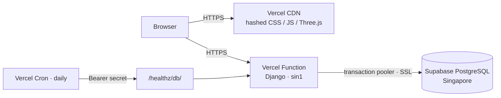
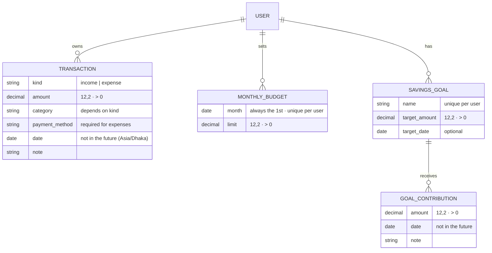

# Taka Koi Gelo? · টাকা কই গেলো?

> *"Where did the money go?"* Know where your money goes, before it disappears.

A personal expense manager for university students in Bangladesh. Log pocket
money, tuition income and everyday spending in taka (৳), set a monthly
budget, and see where the money went, with an interactive **3D wallet**
that reflects your real figures.

**Live demo:** <https://taka-koi-gelo.vercel.app>
(free hosting: the first request after a quiet period can be slow, and the
free database pauses after a week without activity).

<!--
Screenshots: add images to docs/screenshots/ and uncomment.


-->

---

## Why I built it

Students in Bangladesh often juggle money from several sources (pocket money
from family, private tuition, part-time work) and spend it in small amounts:
food, rickshaws, recharge, photocopies. By the end of the month the
question is always *taka koi gelo?* Generic expense trackers feel like
accounting software. This one aims to be quick to use on a phone, honest
about the numbers, and a little playful.

## Features

- **Accounts:** sign up, log in and log out with Django's built-in authentication. Every record is private to its owner.
- **Income and expenses:** add, edit and delete. Kind-specific categories (Pocket money, Tuition… / Food, Transport…), payment methods including bKash, Nagad and Rocket, a date and an optional note.
- **Filters:** by type, category and date range. Filtered views have bookmarkable URLs and paginate.
- **Dashboard ("right now"):**
  - the all-time available balance and this month's income and spending;
  - **safe to spend per day**: budget left ÷ days left, rounded down;
  - the budget card;
  - a **spending pace** line chart: this month's running total against an even pace through the budget and against last month (no projections);
  - goal progress and recent transactions.

  Category breakdowns and reports live on the Stats page.
- **Monthly budget:** limit, amount used, remaining (negative when over), and warnings at 80% and when over.
- **Money insights (`/stats/`):**
  - **Month view:** income, expenses, surplus/deficit, the budget, and spending by category for any month, with previous/next links.
  - **Daily spending:** one bar per day (biggest day highlighted, no-spend days counted), with a **Bars | Calendar** switch. The calendar is Sunday-first, shades each day relative to the month's biggest day, and meets 4.5:1 text contrast. **How you paid** shows expenses by payment method (Cash, bKash, Nagad, Rocket, Card, Bank).
  - **Monthly report:** rule-based insights in two separate groups. **Spending:** the % change from last month, shown only when last month had expenses, and worded "so far" for a month in progress; the largest category, including ties. **Savings goals:** amount contributed, share of income, and the change from last month.
  - **Year view:** January–December compared in a server-drawn SVG bar chart, plus total income and expenses, the year's net, average monthly expenses, and the highest-spending and highest-surplus months.
  - **Year charts:** each month's spending as **stacked category bars** (fixed colour per category, at least 3:1 contrast in both themes, with a category total list underneath), and **budget vs actual** (outlined budget bar, spending green up to the limit and red above it, spending-only for months without a budget).
  - **Surplus/deficit** = recorded income − recorded expenses. A surplus isn't presented as confirmed savings. Months with expenses but **no recorded income** get no surplus/deficit verdict. Over budget stays a separate flag.
  - A table doubles as the accessible version of the chart. On phones the chart scrolls within its card.
- **Savings goals (`/goals/`):** goals with a target and an optional date.
  - Record, edit and delete contributions. Each goal shows contributed, remaining, a percentage and a progress bar; completed goals are listed separately, and overdue ones are flagged.
  - Contributions are kept **separate from expenses**: they never change spending, the budget, surplus/deficit or the available balance.
  - The dashboard shows "set aside for goals" next to the balance. The stats page shows contributions and the **savings rate** (contributions ÷ income × 100, or **N/A** without income).
- **3D wallet (Three.js):** procedural wallet and coins.
  - Coins in the wallet reflect your balance band.
  - A "spent" stack shows this month's expenses.
  - A ring on the table shows budget usage.
  - After a successful save from the dashboard, a coin drops in (income) or flies out (expense), once.
- **Works without 3D:** all figures are server-rendered HTML; the 3D scene is an enhancement. Falls back to an SVG when WebGL is unavailable, respects reduced motion, and pauses when off screen.
- **Mobile first:** bottom tab bar on phones, light and dark mode, WCAG AA contrast, Bangla-English microcopy, and lakh-style number formatting (৳1,23,456.50).

## Tech stack

| Layer | Choice |
|---|---|
| Backend | Python 3.13, Django 5.2 LTS, Django ORM, Django auth |
| Database | PostgreSQL 17 locally (Docker), Supabase PostgreSQL in production |
| Frontend | Django templates, hand-written CSS (no framework), vanilla JavaScript |
| 3D | Three.js 0.186.1, self-hosted and loaded with an import map (no build step) |
| Hosting | Vercel (Django as one Python function plus CDN for static files), Supabase (Singapore) |
| Tooling | Git, GitHub, coverage.py, pip-audit, Docker Compose |

Deliberately **not** used: React, Django REST Framework, Celery, Redis. One
Django project renders the pages and serves the static files.

Developed with help from Claude Code, an AI pair-programming assistant, used
for implementation and review under my direction at each stage.

## Architecture



```
config/      settings (env-driven), root URLs, health checks
accounts/    sign-up view + form (login/logout use Django's built-in views)
finance/
  models.py      Transaction, MonthlyBudget
  forms.py       TransactionForm, TransactionFilterForm, BudgetForm
  services.py    all money calculations + wallet visual mapping
  views.py       thin views: request -> service -> template
  templatetags/  `taka` filter (৳ with lakh grouping)
  charts.py      SVG bar-chart geometry for the stats page
  tests/         9 test modules (accounts/tests.py covers auth)
templates/   base layout, pages, partials, 404/500
static/      css/app.css, js/wallet.js, vendor/three-0.186.1/
```

**How the 3D wallet gets real data:** the dashboard view computes the
summary in `services.py`, renders every figure as HTML, and embeds a few
*visual-only* values with `{{ wallet|json_script:"wallet-data" }}`. Those
values are a coin count, a stack count, a budget-ring fraction and an event
name. `wallet.js` validates and clamps them and only draws. JavaScript never
calculates money.

## Data model



Income and expenses share one table. This keeps the balance, the recent
list and the filters to single queries. Database `CHECK` and `UNIQUE`
constraints back up the model validation.

## How the numbers are defined

| Figure | Definition |
|---|---|
| Available balance | All income ever recorded − all expenses ever recorded (labelled "all time") |
| This month | The calendar month containing today **in Asia/Dhaka**, judged by each transaction's own date |
| Budget remaining | This month's limit − this month's expenses (may be negative) |
| Budget warning | Spent ≥ 80% of the limit (exact comparison, not the rounded percentage) |
| Surplus / deficit | A month's recorded income − recorded expenses. A surplus is *not* presented as savings. A month with expenses but no recorded income gets no verdict. |
| Savings contributions | Money recorded towards goals, in its own table. Never an expense; never subtracted from the balance. |
| Savings rate | Contributions ÷ recorded income × 100 for the period, or "N/A" when there's no income |

All money is `Decimal` with 2 places, from the database to the template. Sums
are done in the database (four queries for the whole dashboard, whatever the
data size) and normalised with `quantize`.

## Security

- **Ownership:** every query is scoped to `request.user`. Another user's record returns **404**, the same as a missing one, so its existence isn't revealed.
- **Trusted fields:** `user` and `kind` never come from form data. Kind is fixed by the URL; owner by the session.
- **CSRF:** a token on every POST form. Delete and logout are POST-only, behind a confirmation page.
- **Escaping:** Django's template auto-escaping, and `json_script` for data passed to JS. Tested with hostile input.
- **Production settings:**
  - `DEBUG` off by default;
  - secrets only in environment variables;
  - HTTPS redirect, secure cookies and HSTS;
  - `X-Frame-Options: DENY`, `nosniff` and a strict referrer policy;
  - `manage.py check --deploy` is clean.
- **Database access:** the Supabase Data API is disabled, so Django is the only way into the data.
- **Dependencies:** audited with `pip-audit`, with no known vulnerabilities at the time of writing.

## Run it locally (Windows / PowerShell)

Prerequisites: Python 3.13, Git, and Docker Desktop (running).

```powershell
git clone https://github.com/nowrinafrinn/Taka-Koi-Gelo-.git
cd Taka-Koi-Gelo-
python -m venv .venv
.venv\Scripts\python.exe -m pip install -r requirements-dev.txt
Copy-Item .env.example .env
docker compose up -d              # PostgreSQL 17 on 127.0.0.1:5433
.venv\Scripts\python.exe manage.py migrate
.venv\Scripts\python.exe manage.py runserver 127.0.0.1:8010
```

Open <http://127.0.0.1:8010>. On macOS or Linux, use `.venv/bin/python`.

### Environment variables

| Variable | Local | Production |
|---|---|---|
| `DJANGO_DEBUG` | `True` | `False` (also the default) |
| `DJANGO_SECRET_KEY` | empty (dev key used) | long random value, **required** |
| `DATABASE_URL` | Docker URL from `.env.example` | Supabase transaction pooler (port 6543) |
| `DB_SSL_REQUIRE` | `False` | `True` |
| `CRON_SECRET` | empty | random value; Vercel Cron sends it as a Bearer token |
| `DJANGO_ALLOWED_HOSTS` | `localhost,127.0.0.1` | only for a custom domain (Vercel hosts are added automatically) |

## Tests

```powershell
.venv\Scripts\python.exe manage.py test
.venv\Scripts\python.exe -m coverage run manage.py test
.venv\Scripts\python.exe -m coverage report
```

**293 tests, 99% line coverage.** The only uncovered lines are
production-only settings, which `check --deploy` verifies. The tests cover:

- **Calculations:** empty data, zero values, negative balance, overspending, Decimal precision (1,000 × ৳0.10 = ৳100.00), and month boundaries including leap years and the Dhaka-midnight case.
- **Access control:** login required on every private page; another user's records give 404 for view, edit and delete; tampered `user`/`kind` fields are ignored; CSRF is enforced on every form.
- **Forms:** invalid amounts, wrong categories for the kind, future dates, filters and pagination.
- **3D data:** the wallet mapping; save animations only after a *successful* save, and only once.
- **Ops:** health checks, error pages, security headers, and dependency files staying in sync.

## Deployment

Pushing to `main` deploys to Vercel. The build installs dependencies, runs
`collectstatic` with hashed filenames, then runs `migrate` against Supabase
through a build hook in `pyproject.toml`. Full guide, free-tier limits and
troubleshooting: [docs/DEPLOYMENT.md](docs/DEPLOYMENT.md).

## Known limitations

- **Login attempts aren't rate-limited**, and there's no password reset (no email sending).
- **No Content-Security-Policy header yet.** Inline styles and the import map would need nonces.
- **Only the current month's budget is editable;** categories are fixed.
- **Three.js is served unminified** (≈2.1 MB raw; the CDN compresses it, and the core file alone arrives at ≈0.29 MB).
- **The 3D coin count uses fixed balance bands**, so ৳20,000 and ৳2,00,000 both show five coins.
- **Free-tier hosting:** Supabase pauses idle projects and has no automatic backups. Preview deployments share the production database.

## Future improvements

- Rate limiting and password reset by email
- Custom categories and recurring transactions (e.g. monthly pocket money)
- Comparison with last month, and simple trends
- CSV export
- A CSP header with nonces; a minified, tree-shaken Three.js bundle
- An installable PWA with offline entry

## Credits

- [Three.js](https://threejs.org) (MIT licence, see `static/vendor/three-0.186.1/LICENSE.txt`)
- Fonts: Bricolage Grotesque, Hind Siliguri and Galada, via Google Fonts
